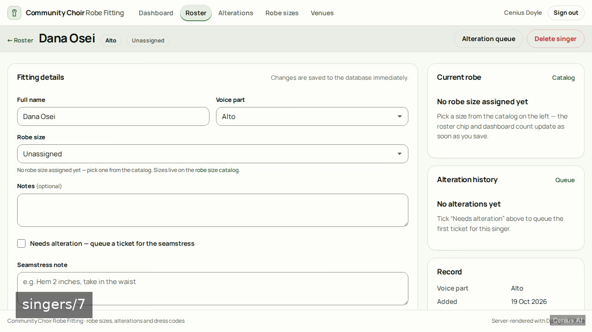
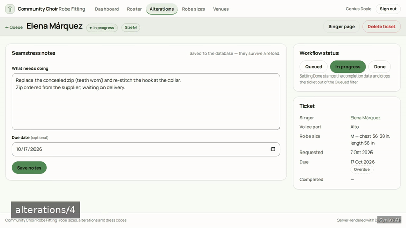
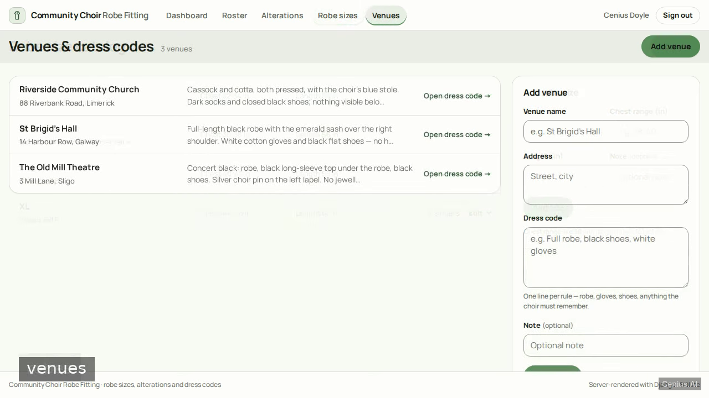
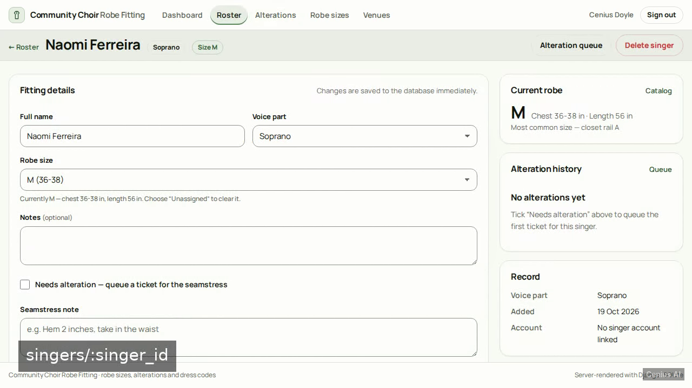
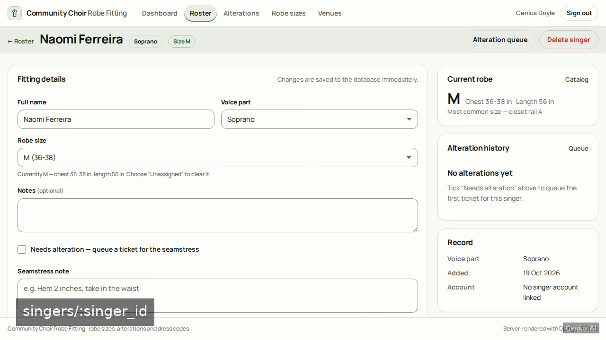

# Community Choir Robe Fitting — production-ready Django monitoring dashboard starter

If you want a self-hosted monitoring dashboard without the vendor lock-in, **Community Choir Robe Fitting** is ready to run. Built with Django and Apache-2.0-licensed, Community Choir Robe Fitting ships complete — one clone, one install command. We will build a server-rendered Django application, run with `python manage.py runserver` and Django templates throughout, that lets one director account manage a community choir's robe fittings: a singer roster with…. [Open Community Choir Robe Fitting on cenius.ai](https://cenius.ai/marketplace/p/community-choir-robe-fitting?ref=gh&utm_campaign=community-choir-robe-fitting-django) to customise it without touching a line of Community Choir Robe Fitting code.


[](LICENSE)  [](https://cenius.ai)

[](https://cenius.ai/marketplace/p/community-choir-robe-fitting?ref=gh&utm_campaign=community-choir-robe-fitting-django)

> **▶ [Open & edit in cenius.ai](https://cenius.ai/marketplace/p/community-choir-robe-fitting?ref=gh&utm_campaign=community-choir-robe-fitting-django)** — one click to an editable workspace: describe changes in plain English, get an instant preview, one-click deploy and host. Modifications made on the platform come with full rebrand & relicense rights.

_Local clone? See [Quick start](#quick-start) below. cenius.ai is the zero-setup path._

## Demo





▶ **[Video walkthrough](https://cenius.ai/marketplace/p/community-choir-robe-fitting?ref=gh&utm_campaign=community-choir-robe-fitting-django)** — see the app in action on the cenius.ai project page · [MP4 file](.github/media/demo.mp4)

## Screenshots

  

## Architecture

The repository contains 57 files of Django source, organised under `choirfit/`, `singers/`, `static/`, `templates/`. One command (`./install.sh`) covers dependency setup and demo-data seeding. See [`INSTALL.md`](INSTALL.md) for complete setup instructions.

## Features

- Sign-in with role-based landing
- Director dashboard overview
- Singer roster CRUD
- Robe size assigned per singer
- Robe size catalog
- Alteration queue with seamstress notes
- Concert dress code by venue
- Singer self-service robe view

## Quick start

```bash
./install.sh   # installs dependencies + seeds demo data
```

See [`INSTALL.md`](INSTALL.md) for full setup and usage instructions.

## Usage guide

Two people use this app: the **choir director**, who manages everything, and a **singer**,
who only ever sees their own robe. Everything is server-rendered — every form is a normal
POST with server-side validation, so the whole product works without JavaScript.

### Signing in

1. Open <http://127.0.0.1:8000/> — you are redirected to `/accounts/login/`.
2. Sign in with `cenius` / `cenius` (or `cenius@cenius.ai` / `cenius`), or tap
   **Sign in as the demo director**. Singers use their own username and password.
3. The director lands on `/dashboard/`; a singer lands on `/me/`.
4. A wrong password shows one message — *Those credentials did not match our records* — and
   keeps the username you typed. It never says which field was wrong.
5. **Sign out** is always in the top bar and returns you to the sign-in card with a notice.

If a singer opens a director page (`/singers/`, `/dashboard/`, …) the server answers 403
with a link straight back to their own robe page — nothing is written to the database.

### The director dashboard (`/dashboard/`)

The bento shows, live from the database:

_Full guide: [`USAGE.md`](USAGE.md)_

## FAQ

### What does it take to self-host Community Choir Robe Fitting?

It runs entirely on your own machine. Clone, run `./install.sh`, and follow [`INSTALL.md`](INSTALL.md) — the whole stack is in this repo, no external dependencies required.

### Is it OK to ship Community Choir Robe Fitting as part of a product?

Confirmed free for commercial use — MIT terms let you incorporate, resell, or ship it in any product. [LICENSE](LICENSE).

### What is Community Choir Robe Fitting built with?

Powered by Django. This repo is the real thing — full source, seed data, and all — ready to clone and start up. Highlights include concert dress code by venue.

### Can non-developers customise Community Choir Robe Fitting?

Non-developers can use [cenius.ai](https://cenius.ai/marketplace/p/community-choir-robe-fitting?ref=gh&utm_campaign=community-choir-robe-fitting-django) to make changes. Describe your goal in everyday language and the platform delivers an updated, ready-to-run project — zero coding on your part.

### Is it possible to white-label Community Choir Robe Fitting for a client?

Rebranding is straightforward under the MIT license — change what you want in the source. Or [open it on cenius.ai](https://cenius.ai/marketplace/p/community-choir-robe-fitting?ref=gh&utm_campaign=community-choir-robe-fitting-django): the platform handles the changes and grants full rebrand rights on the result.

## License & rebranding

Released under the [Apache License 2.0](LICENSE) (© 2026 Cenius AI) — free for personal and commercial use. The Cenius name/logo are trademarks (see NOTICE).

**Need a customized version?** [Remix this app on cenius.ai](https://cenius.ai/marketplace/p/community-choir-robe-fitting?ref=gh&utm_campaign=community-choir-robe-fitting-django) — modifications made on the platform come with **full rebrand & relicense rights** over your derivative.

## Built with cenius.ai

This entire application — code, design, seeded demo data — was generated on **[cenius.ai](https://cenius.ai)** from a plain-English description.

- 🚀 [Build your own app on cenius.ai](https://cenius.ai)
- 🎛️ [Remix Community Choir Robe Fitting on the marketplace](https://cenius.ai/marketplace/p/community-choir-robe-fitting?ref=gh&utm_campaign=community-choir-robe-fitting-django) — open it in a workspace, prompt for changes, and ship your own version.

More open-source apps: [the Cenius-ai catalog](https://github.com/Cenius-ai) · [showcase index](https://github.com/Cenius-ai/showcase)
